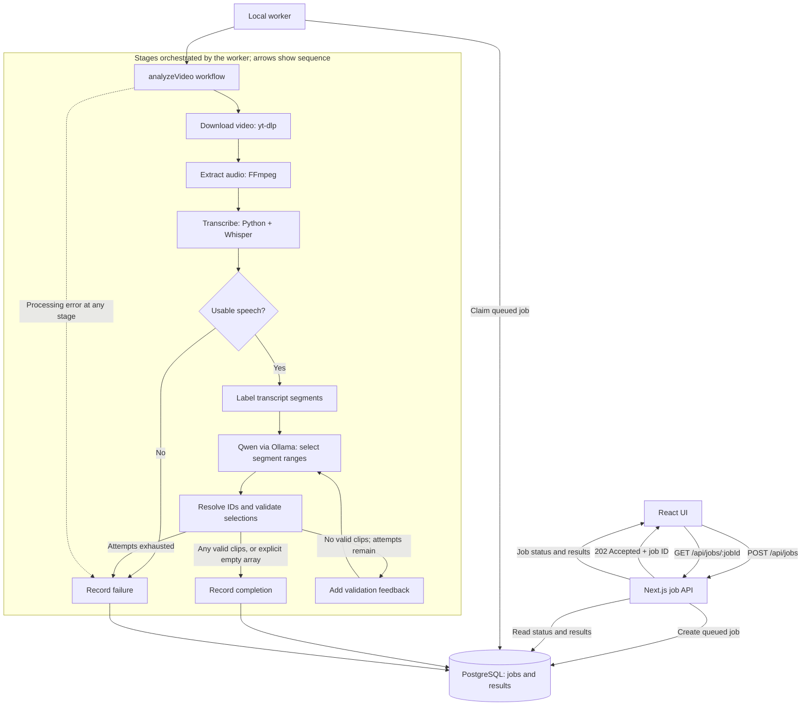

# Shorts Generator

The application accepts a YouTube URL, processes the video locally, creates a
transcript, and asks a local Ollama model to suggest useful short-form clips.

## Local architecture



PostgreSQL provides durable job storage and local queued-work delivery. The
worker orchestrates the tools; the sequence arrows do not mean yt-dlp, FFmpeg,
Whisper, or Ollama directly call one another. SQS and AWS hosting remain future
options, not requirements for the current local workload.

### Processing behavior and limits

- Existing video, audio, and transcript files may be reused instead of regenerated.
- Empty or punctuation-only transcripts are rejected before suggestion generation.
  This check does not establish that the remaining transcription is accurate.
- Qwen selects labeled segment ranges. Code resolves IDs to source timestamps and
  rejects unknown IDs, reversed/invalid ranges, and durations outside 15-90 seconds.
- Generation allows at most three model calls: the initial attempt plus two
  validation retries. Feedback describes rejected ranges. Network/HTTP errors
  are not retried by this validation loop.
- Mixed responses return valid clips and discard invalid ones without retrying to
  fill the count. An explicit empty array is a valid completed result with no clips.
- JSON validity and duration checks do not guarantee English-language compliance,
  grounding, or editorial usefulness. Review suggestions against the source video.
- Each worker processes one job at a time. Multiple-job UI tracking is not yet
  implemented; the current page tracks one job and blocks further active submissions.
- Active-video deduplication is not fully integrated into job creation. Row claiming
  prevents duplicate claims of one job, not separate jobs for the same video.
- Automatic worker crash recovery is not implemented. A worker that exits after
  claiming a job can leave it marked `processing`; restarting alone does not reclaim it.
- Video export has been tried manually with FFmpeg; automatic export through the
  interface, captions, and vertical reframing are not implemented.

See the [backlog](TODO.md) for deferred work and the
[experiment history](docs/experiments/clip-selection.md) for observations and
remaining uncertainty.

## Prerequisites

- Node.js
- Docker Desktop
- `yt-dlp`
- FFmpeg
- Python and the transcription dependencies used by `scripts/transcribe.py`
- Ollama with the model configured in `lib/generateClipSuggestions.ts`

## Environment

Copy `.env.example` to `.env` and replace the example password. The development
and test databases use separate connection strings.

## Set up PostgreSQL

Open Docker Desktop and wait for its engine to start, then start PostgreSQL:

```bash
docker compose up -d postgres
```

Create the test database once:

```bash
docker compose exec postgres sh -lc \
  'createdb -U "$POSTGRES_USER" shorts_generator_test'
```

Apply the migrations to both databases:

```bash
npm run db:migrate
npm run db:migrate:test
```

## Run the application

Ensure PostgreSQL is healthy (`docker compose ps`) and Ollama is running. The
current configured model is `qwen3:8b`; download it once if needed:

```bash
ollama pull qwen3:8b
```

If Ollama is not already serving, run `ollama serve` in a separate terminal.

Use two additional terminals. Start Next.js in the first:

```bash
npm run dev
```

Start the local processing worker in the second:

```bash
npm run worker
```

Open [http://localhost:3000](http://localhost:3000), submit a YouTube URL, and
leave both processes running. The API returns a job ID immediately, the worker
processes the queued job, and the frontend polls until the job completes or
fails.

Restart `npm run worker` after changing worker or model-generation source; it does
not automatically reload changes. Confirm the port printed by Next.js and avoid
leaving an older production server or unintended extra worker running.

## Verification

```bash
npm run lint
npm run typecheck
npm run test:unit
npm run test:integration
npm run build
```

The repository integration tests connect to `shorts_generator_test`, apply no
mocks to PostgreSQL, and clean up the rows they create.

## Design decisions

- [ADR 0001](docs/adr/0001-asynchronous-video-processing.md): asynchronous-processing rationale.
- [ADR 0002](docs/adr/0002-local-postgresql-job-delivery.md): current PostgreSQL polling boundary.
- [ADR 0003](docs/adr/0003-segment-selection-and-bounded-validation-retries.md): segment selection and bounded validation feedback.
- [Documentation index](docs/README.md): task records, workflow, and experiment history.
