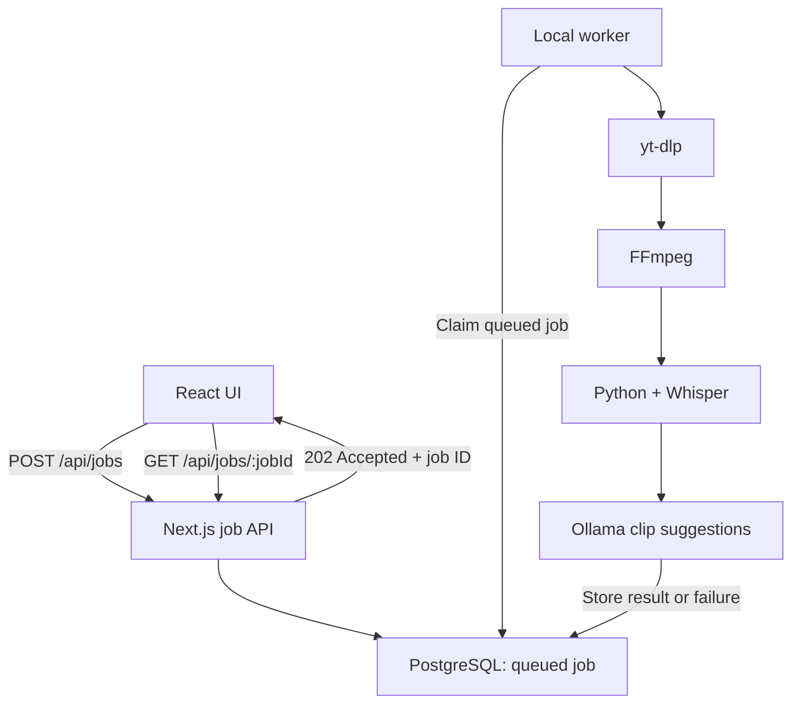

# Shorts Generator

The application accepts a YouTube URL, processes the video locally, creates a
transcript, and asks a local Ollama model to suggest useful short-form clips.

## Local architecture



PostgreSQL acts as both durable job storage and the local development queue.
SQS will replace the polling boundary in a later AWS milestone, after the local
job lifecycle has been verified.

## Prerequisites

- Node.js
- Docker Desktop
- `yt-dlp`
- FFmpeg
- Python and the transcription dependencies used by `scripts/transcribe.py`
- Ollama with the model configured in `lib/generateClipSuggestions.ts`

## Environment

Copy `.env.example` to `.env` and replace the example password. The development
and test databases use separate connection strings.

## Set up PostgreSQL

Start PostgreSQL:

```bash
docker compose up -d postgres
```

Create the test database once:

```bash
docker compose exec postgres sh -lc \
  'createdb -U "$POSTGRES_USER" shorts_generator_test'
```

Apply the migrations to both databases:

```bash
npm run db:migrate
npm run db:migrate:test
```

## Run the application

Use two terminals. Start Next.js in the first:

```bash
npm run dev
```

Start the local processing worker in the second:

```bash
npm run worker
```

Open [http://localhost:3000](http://localhost:3000), submit a YouTube URL, and
leave both processes running. The API returns a job ID immediately, the worker
processes the queued job, and the frontend polls until the job completes or
fails.

## Verification

```bash
npm run lint
npm run typecheck
npm run test:unit
npm run test:integration
npm run build
```

The repository integration tests connect to `shorts_generator_test`, apply no
mocks to PostgreSQL, and clean up the rows they create.

## Design decisions

See [ADR 0001](docs/adr/0001-asynchronous-video-processing.md) for the reasoning
behind separating request submission from expensive video processing.
